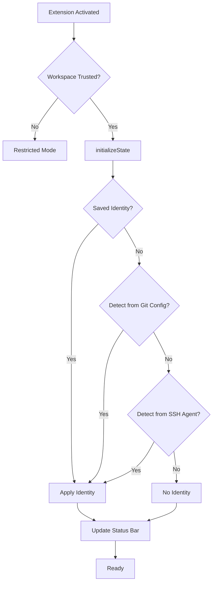

# nullvariant-vscode-extensions

[](https://github.com/nullvariant/nullvariant-vscode-extensions/actions/workflows/ci.yml)
[](https://github.com/nullvariant/nullvariant-vscode-extensions/actions/workflows/security.yml)
[](https://github.com/nullvariant/nullvariant-vscode-extensions/actions/workflows/ci.yml)
[](SECURITY.md#build-provenance)
[](https://github.com/nullvariant/nullvariant-vscode-extensions#supply-chain-security)
[](https://github.com/nullvariant/nullvariant-vscode-extensions#supply-chain-security)
[](https://securityscorecards.dev/viewer/?uri=github.com/nullvariant/nullvariant-vscode-extensions)
[](https://www.bestpractices.dev/projects/11709)
[](https://github.com/step-security/harden-runner)
[](https://snyk.io/)
[](https://socket.dev/dashboard/org/null-variant/repo/nullvariant-vscode-extensions)
[](https://www.gitguardian.com/)
[](https://github.com/gitleaks/gitleaks)
[](https://results.pre-commit.ci/latest/github/nullvariant/nullvariant-vscode-extensions/main)
[](#contributors)
[](https://renovatebot.com)
[](https://app.fossa.com/projects/git%2Bgithub.com%2Fnullvariant%2Fnullvariant-vscode-extensions?ref=badge_shield&issueType=license)
[](https://app.fossa.com/projects/git%2Bgithub.com%2Fnullvariant%2Fnullvariant-vscode-extensions?ref=badge_shield&issueType=security)
[](https://codecov.io/gh/nullvariant/nullvariant-vscode-extensions)
[](https://sonarcloud.io/summary/new_code?id=nullvariant_nullvariant-vscode-extensions)
[](https://sonarcloud.io/summary/new_code?id=nullvariant_nullvariant-vscode-extensions)
[](https://sonarcloud.io/summary/new_code?id=nullvariant_nullvariant-vscode-extensions)
[](https://sonarcloud.io/summary/new_code?id=nullvariant_nullvariant-vscode-extensions)
[](https://sonarcloud.io/summary/new_code?id=nullvariant_nullvariant-vscode-extensions)
[](https://qlty.sh/gh/nullvariant/projects/nullvariant-vscode-extensions)

VS Code extensions by [Null;Variant](https://github.com/nullvariant).

## Extensions

### Git ID Switcher

<table>
  <tr>
    <td align="center" valign="top" width="150">
      
    </td>
    <td>
      Switch between multiple Git identities with one click. Manage multiple GitHub accounts, SSH keys, GPG signing, and <b>automatically apply identity to Git Submodules</b>.
      <br><br>
      <a href="https://open-vsx.org/extension/nullvariant/git-id-switcher"></a>
      <a href="https://opensource.org/licenses/MIT"></a>
      <a href="https://github.com/nullvariant/nullvariant-vscode-extensions/blob/main/extensions/git-id-switcher/docs/DESIGN_PHILOSOPHY.md"></a> <a href="https://www.anthropic.com/claude-code"></a> <a href="https://developers.openai.com/codex"></a>
      <br>
      <a href="https://github.com/nullvariant/nullvariant-vscode-extensions/blob/main/extensions/git-id-switcher/docs/LANGUAGES.md"></a> <b>🇺🇸</b> <a href="https://github.com/nullvariant/nullvariant-vscode-extensions/blob/main/extensions/git-id-switcher/docs/i18n/ja/README.md">🇯🇵</a> <a href="https://github.com/nullvariant/nullvariant-vscode-extensions/blob/main/extensions/git-id-switcher/docs/i18n/zh-CN/README.md">🇨🇳</a> <a href="https://github.com/nullvariant/nullvariant-vscode-extensions/blob/main/extensions/git-id-switcher/docs/i18n/zh-TW/README.md">🇹🇼</a> <a href="https://github.com/nullvariant/nullvariant-vscode-extensions/blob/main/extensions/git-id-switcher/docs/i18n/ko/README.md">🇰🇷</a> <a href="https://github.com/nullvariant/nullvariant-vscode-extensions/blob/main/extensions/git-id-switcher/docs/i18n/de/README.md">🇩🇪</a> <a href="https://github.com/nullvariant/nullvariant-vscode-extensions/blob/main/extensions/git-id-switcher/docs/i18n/fr/README.md">🇫🇷</a> <a href="https://github.com/nullvariant/nullvariant-vscode-extensions/blob/main/extensions/git-id-switcher/docs/i18n/es/README.md">🇪🇸</a> <a href="https://github.com/nullvariant/nullvariant-vscode-extensions/blob/main/extensions/git-id-switcher/docs/i18n/pt-BR/README.md">🇧🇷</a> <a href="https://github.com/nullvariant/nullvariant-vscode-extensions/blob/main/extensions/git-id-switcher/docs/i18n/it/README.md">🇮🇹</a> <a href="https://github.com/nullvariant/nullvariant-vscode-extensions/blob/main/extensions/git-id-switcher/docs/i18n/ru/README.md">🇷🇺</a> <a href="https://github.com/nullvariant/nullvariant-vscode-extensions/blob/main/extensions/git-id-switcher/docs/i18n/pl/README.md">🇵🇱</a> <a href="https://github.com/nullvariant/nullvariant-vscode-extensions/blob/main/extensions/git-id-switcher/docs/i18n/tr/README.md">🇹🇷</a> <a href="https://github.com/nullvariant/nullvariant-vscode-extensions/blob/main/extensions/git-id-switcher/docs/i18n/cs/README.md">🇨🇿</a> <a href="https://github.com/nullvariant/nullvariant-vscode-extensions/blob/main/extensions/git-id-switcher/docs/i18n/hu/README.md">🇭🇺</a> <a href="https://github.com/nullvariant/nullvariant-vscode-extensions/blob/main/extensions/git-id-switcher/docs/i18n/bg/README.md">🇧🇬</a> <a href="https://github.com/nullvariant/nullvariant-vscode-extensions/blob/main/extensions/git-id-switcher/docs/i18n/uk/README.md">🇺🇦</a> <a href="https://github.com/nullvariant/nullvariant-vscode-extensions/blob/main/extensions/git-id-switcher/docs/i18n/eo/README.md">🌍</a> <a href="https://github.com/nullvariant/nullvariant-vscode-extensions/blob/main/extensions/git-id-switcher/docs/i18n/haw/README.md">🌺</a> <a href="https://github.com/nullvariant/nullvariant-vscode-extensions/blob/main/extensions/git-id-switcher/docs/i18n/ain/README.md">🐻</a> <a href="https://github.com/nullvariant/nullvariant-vscode-extensions/blob/main/extensions/git-id-switcher/docs/i18n/ryu/README.md">🐉</a> <a href="https://github.com/nullvariant/nullvariant-vscode-extensions/blob/main/extensions/git-id-switcher/docs/i18n/tok/README.md">✨</a> <a href="https://github.com/nullvariant/nullvariant-vscode-extensions/blob/main/extensions/git-id-switcher/docs/i18n/tlh/README.md">🖖</a> <a href="https://github.com/nullvariant/nullvariant-vscode-extensions/blob/main/extensions/git-id-switcher/docs/i18n/x-lolcat/README.md">🐱</a> <a href="https://github.com/nullvariant/nullvariant-vscode-extensions/blob/main/extensions/git-id-switcher/docs/i18n/x-pirate/README.md">🏴‍☠️</a> <a href="https://github.com/nullvariant/nullvariant-vscode-extensions/blob/main/extensions/git-id-switcher/docs/i18n/x-shakespeare/README.md">🎭</a>
      <br><br>
      <a href="extensions/git-id-switcher/#readme">📖 Documentation</a> | <a href="extensions/git-id-switcher/docs/ARCHITECTURE.md">🏗 Architecture</a> | <a href="extensions/git-id-switcher/docs/THREAT_MODEL.md">🛡 Threat Model</a> | <a href="extensions/git-id-switcher/docs/LANGUAGES.md">🌐 Languages</a> | <a href="extensions/git-id-switcher/docs/CONTRIBUTING.md">🤝 Contributing</a> | <a href="https://marketplace.visualstudio.com/items?itemName=nullvariant.git-id-switcher">📦 Marketplace</a> | <a href="https://open-vsx.org/extension/nullvariant/git-id-switcher">📦 Open VSX</a>
    </td>
  </tr>
</table>

<br>


## Quick Start for Developers

Get started in 5 steps:

```bash
# 1. Clone
git clone https://github.com/nullvariant/nullvariant-vscode-extensions.git
cd nullvariant-vscode-extensions

# 2. Install dependencies (from repository root)
npm install

# 3. Compile
npm run compile:all

# 4. Run tests
npm run test:all

# 5. Start watch mode for development
npm run watch:all
```

For linting: `npm run lint:all`

## Extension Initialization Flow



## Development

### Prerequisites

- Node.js 20+

### Working on an extension

```bash
cd extensions/git-id-switcher

# Install dependencies
npm install

# Compile
npm run compile

# Watch mode
npm run watch

# Package as VSIX
npm run package
```

### Testing locally

#### Manual Testing

1. Open the extension folder in VS Code
2. Press `F5` to launch Extension Development Host
3. Test the extension in the new window

#### Unit Tests

```bash
cd extensions/git-id-switcher
npm run test
```

#### E2E Tests

E2E tests run in an actual VS Code environment using `@vscode/test-electron`:

```bash
cd extensions/git-id-switcher
npm run test:e2e
```

> **Note**: On first run, VS Code will be downloaded automatically (~100MB). Subsequent runs use the cached version.

### Git Hooks Setup

`npm install` sets up the git hooks with husky (`.husky/`): `pre-commit` formats staged Markdown and regenerates derived documentation files, `commit-msg` chains to the maintainer's parent repository, and `pre-push` blocks direct pushes to `main`. Contributors working outside the parent repository commit with `HUSKY=0` (see [CONTRIBUTING.md](CONTRIBUTING.md#git-hooks)).

## Repository Structure

```
nullvariant-vscode-extensions/
├── extensions/
│   └── git-id-switcher/
├── .github/workflows/
│   ├── build-vsix.yml
│   ├── ci.yml
│   └── publish.yml
├── .husky/
│   ├── commit-msg
│   ├── pre-commit
│   └── pre-push
├── LICENSE
└── README.md
```

## Publishing (Maintainers Only)

> **Note**: The `main` branch is protected. All changes must go through a Pull Request.

Releases start from a version bump; release tags are never pushed by hand:

1. Open a Pull Request that bumps the version in `extensions/git-id-switcher/package.json` and adds a `CHANGELOG.md` entry, and merge it to `main`
2. [`auto-tag.yml`](.github/workflows/auto-tag.yml) pushes the tag `git-id-switcher-v<version>` with the release tagging GitHub App. Only this App can create release tags
3. The [publish workflow](.github/workflows/publish.yml) builds and signs the extension, then waits for the maintainer's approval of the `production` environment before publishing to VS Code Marketplace and Open VSX (each registry is enabled by the repository variables `PUBLISH_TO_MARKETPLACE` and `PUBLISH_TO_OPENVSX`)

## Supply Chain Security

Every release includes cryptographic verification artifacts:

| Artifact              | Description                                                  |
| --------------------- | ------------------------------------------------------------ |
| `*.vsix`              | The extension package                                        |
| `*.vsix.intoto.jsonl` | Build provenance (SLSA v1.0 Build Level 3 from 0.19.9)       |
| `*.vsix.bundle`       | Cosign keyless signature (Sigstore)                          |
| `sbom-cyclonedx.json` | CycloneDX SBOM (attested when the attestation step succeeds) |

### Verify VSIX signature (Cosign)

```bash
# Download the VSIX and its .bundle from the GitHub Release, then:
cosign verify-blob git-id-switcher-<version>.vsix \
  --bundle git-id-switcher-<version>.vsix.bundle \
  --certificate-identity-regexp="https://github.com/nullvariant/nullvariant-vscode-extensions/" \
  --certificate-oidc-issuer="https://token.actions.githubusercontent.com"
```

### Verify SLSA provenance (GitHub CLI)

```bash
gh attestation verify git-id-switcher-<version>.vsix \
  --repo nullvariant/nullvariant-vscode-extensions \
  --signer-workflow nullvariant/nullvariant-vscode-extensions/.github/workflows/build-vsix.yml \
  --source-ref refs/tags/git-id-switcher-v<version> \
  --deny-self-hosted-runners
```

For releases starting with 0.19.9, the provenance is signed by the reusable build workflow, and the release is published only after this check passes. See [SECURITY.md](SECURITY.md#build-provenance) for how this meets SLSA v1.0 Build Level 3. Releases 0.10.35 through 0.19.8 were attested by `publish.yml`; use `--signer-workflow nullvariant/nullvariant-vscode-extensions/.github/workflows/publish.yml` for them.

### Verify SBOM attestation (GitHub CLI)

```bash
gh attestation verify git-id-switcher-<version>.vsix \
  --repo nullvariant/nullvariant-vscode-extensions \
  --predicate-type https://cyclonedx.org/bom \
  --signer-workflow nullvariant/nullvariant-vscode-extensions/.github/workflows/build-vsix.yml \
  --source-ref refs/tags/git-id-switcher-v<version> \
  --deny-self-hosted-runners
```

## Extension Fingerprint

Use this information to verify you have the authentic Git ID Switcher extension:

| Field        | Value                                                                             |
| ------------ | --------------------------------------------------------------------------------- |
| Publisher    | `nullvariant`                                                                     |
| Extension ID | `nullvariant.git-id-switcher`                                                     |
| Repository   | `https://github.com/nullvariant/nullvariant-vscode-extensions`                    |
| Marketplace  | `https://marketplace.visualstudio.com/items?itemName=nullvariant.git-id-switcher` |
| Open VSX     | `https://open-vsx.org/extension/nullvariant/git-id-switcher`                      |

If you find an extension with a similar name from a different publisher, please report it (see [SECURITY.md](SECURITY.md#reporting-typosquatting)).

## See Also

- [GOVERNANCE.md](GOVERNANCE.md) — Project governance model
- [CODE_OF_CONDUCT.md](CODE_OF_CONDUCT.md) — Garden etiquette
- [CONTRIBUTING.md](CONTRIBUTING.md) — How to contribute
- [SECURITY.md](SECURITY.md) — Security policy and vulnerability reporting
- [AGENTS.md](AGENTS.md) — Constraints for AI-assisted contributions

## Contributors

The people, apprentices, and bots who tend this garden ([emoji key](https://allcontributors.org/emoji-key/)):

<!-- ALL-CONTRIBUTORS-LIST:START - Do not remove or modify this section -->
<!-- prettier-ignore-start -->
<!-- markdownlint-disable -->
<table>
  <tbody>
    <tr>
      <td align="center" valign="top" width="14.29%"><a href="https://nullvariant.com/"><br /><sub><b>Null;Variant</b></sub></a><br /><a href="#code-nullvariant" title="Code">💻</a> <a href="#doc-nullvariant" title="Documentation">📖</a> <a href="#maintenance-nullvariant" title="Maintenance">🚧</a></td>
      <td align="center" valign="top" width="14.29%"><a href="https://github.com/claude"><br /><sub><b>🧹 Claude</b></sub></a><br /><a href="#code-claude" title="Code">💻</a> <a href="#doc-claude" title="Documentation">📖</a> <a href="#maintenance-claude" title="Maintenance">🚧</a></td>
      <td align="center" valign="top" width="14.29%"><a href="https://github.com/codex"><br /><sub><b>🧹 Codex</b></sub></a><br /><a href="#security-codex" title="Security">🛡️</a> <a href="#review-codex" title="Reviewed Pull Requests">👀</a> <a href="#code-codex" title="Code">💻</a></td>
      <td align="center" valign="top" width="14.29%"><a href="https://github.com/ona-agent"><br /><sub><b>Ona</b></sub></a><br /><a href="#code-ona-agent" title="Code">💻</a></td>
      <td align="center" valign="top" width="14.29%"><a href="https://github.com/apps/nullvariant-justice"><br /><sub><b>👮 Justice</b></sub></a><br /><a href="#review-nullvariant-justice[bot]" title="Reviewed Pull Requests">👀</a> <a href="#security-nullvariant-justice[bot]" title="Security">🛡️</a></td>
      <td align="center" valign="top" width="14.29%"><a href="https://github.com/apps/nullvariant-luna"><br /><sub><b>👧 Luna</b></sub></a><br /><a href="#research-nullvariant-luna[bot]" title="Research">🔬</a> <a href="#review-nullvariant-luna[bot]" title="Reviewed Pull Requests">👀</a></td>
      <td align="center" valign="top" width="14.29%"><a href="https://github.com/apps/nullvariant-slow"><br /><sub><b>🦥 Slow</b></sub></a><br /><a href="#review-nullvariant-slow[bot]" title="Reviewed Pull Requests">👀</a> <a href="#maintenance-nullvariant-slow[bot]" title="Maintenance">🚧</a></td>
    </tr>
    <tr>
      <td align="center" valign="top" width="14.29%"><a href="https://github.com/apps/nullvariant-blaze"><br /><sub><b>🐗 Blaze</b></sub></a><br /><a href="#review-nullvariant-blaze[bot]" title="Reviewed Pull Requests">👀</a> <a href="#infra-nullvariant-blaze[bot]" title="Infrastructure (Hosting, Build-Tools, etc)">🚇</a></td>
      <td align="center" valign="top" width="14.29%"><a href="https://github.com/apps/nullvariant-ciel"><br /><sub><b>🕊️ Ciel</b></sub></a><br /><a href="#review-nullvariant-ciel[bot]" title="Reviewed Pull Requests">👀</a> <a href="#projectManagement-nullvariant-ciel[bot]" title="Project Management">📆</a></td>
      <td align="center" valign="top" width="14.29%"><a href="https://github.com/apps/nullvariant-mimi"><br /><sub><b>🐰 Mimi</b></sub></a><br /><a href="#review-nullvariant-mimi[bot]" title="Reviewed Pull Requests">👀</a> <a href="#test-nullvariant-mimi[bot]" title="Tests">⚠️</a></td>
      <td align="center" valign="top" width="14.29%"><a href="https://github.com/apps/dependabot"><br /><sub><b>Dependabot</b></sub></a><br /><a href="#maintenance-dependabot[bot]" title="Maintenance">🚧</a> <a href="#security-dependabot[bot]" title="Security">🛡️</a></td>
      <td align="center" valign="top" width="14.29%"><a href="https://github.com/apps/renovate"><br /><sub><b>Renovate</b></sub></a><br /><a href="#maintenance-renovate[bot]" title="Maintenance">🚧</a> <a href="#security-renovate[bot]" title="Security">🛡️</a></td>
      <td align="center" valign="top" width="14.29%"><a href="https://github.com/apps/pre-commit-ci"><br /><sub><b>pre-commit.ci</b></sub></a><br /><a href="#maintenance-pre-commit-ci[bot]" title="Maintenance">🚧</a> <a href="#security-pre-commit-ci[bot]" title="Security">🛡️</a></td>
      <td align="center" valign="top" width="14.29%"><a href="https://github.com/apps/mend-bolt-for-github"><br /><sub><b>Mend Bolt</b></sub></a><br /><a href="#security-mend-bolt-for-github[bot]" title="Security">🛡️</a></td>
    </tr>
    <tr>
      <td align="center" valign="top" width="14.29%"><a href="https://github.com/apps/imgbot"><br /><sub><b>ImgBot</b></sub></a><br /><a href="#maintenance-imgbot[bot]" title="Maintenance">🚧</a></td>
      <td align="center" valign="top" width="14.29%"><a href="https://github.com/apps/allcontributors"><br /><sub><b>AllContributors</b></sub></a><br /><a href="#doc-allcontributors[bot]" title="Documentation">📖</a></td>
      <td align="center" valign="top" width="14.29%"><a href="https://github.com/apps/github-actions"><br /><sub><b>GitHub Actions</b></sub></a><br /><a href="#infra-github-actions[bot]" title="Infrastructure (Hosting, Build-Tools, etc)">🚇</a></td>
    </tr>
  </tbody>
</table>

<!-- markdownlint-restore -->
<!-- prettier-ignore-end -->

<!-- ALL-CONTRIBUTORS-LIST:END -->

## License

MIT
